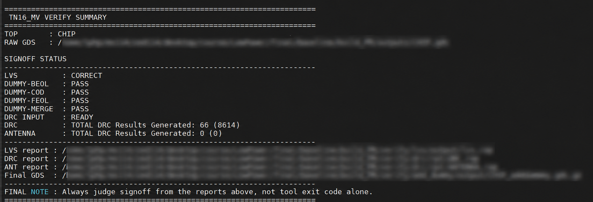

# Low Power APR 整合流程

從低功耗設計概念，走向實際的晶片後端實作。

這是一套以學生與研究用途為出發點整理的 **Low Power APR 整合流程**，希望協助正在學習 APR、研究低功耗設計，或建立研究用晶片實作環境的使用者，少走一些摸索工具與串接流程的彎路。

**依作者的實作經驗，這套流程曾搭配知名晶圓代工廠的先進製程資源進行實際操作與流程驗證，並非只有概念性的腳本範例。** 公開版本保留流程架構，製程專屬設定以填空範本呈現，不提供原驗證環境的受限資源。使用者須自行準備合法授權的 EDA 工具、PDK 與元件庫，並依自己的環境重新驗證。

上述經驗不是晶圓廠官方認證，也不代表完成投片、矽後驗證，或保證所有製程與工具版本皆可直接執行。

## 原驗證環境的結果摘要

此圖為作者提供的原環境驗證摘要，路徑已模糊。LVS 顯示 `CORRECT`，Dummy 各階段顯示 `PASS`，Antenna 顯示零結果；DRC 顯示 `66 (8614)`，因此這張圖不代表 DRC clean 或全部 signoff 通過。圖中結果不等同於公開填空範本重新執行後的驗證。

## 流程內容

本專案整理了設計匯入、Floorplan、Power Planning、Placement、CTS、Routing，以及輸出與實體驗證銜接所需的腳本與設定，並包含低功耗設計整合及問題檢查、定位與修復的輔助工具。

使用者設定保留在原有 config 檔案中，以直接填值的方式配置，不需要透過額外的動態載入層取得設定。各欄位附有填寫提示；cell 類型提示仍須配合本地 library 核對接腳、供電、控制極性與功能。

## 從這裡開始

1. 閱讀 [使用引導](baseline/START_HERE.md)，了解設定與執行順序。
2. 依 [config 填寫指南](baseline/guide/CONFIG_FILL_GUIDE.md) 配置本地工具與製程資源。
3. 對照 [Script config 參數說明](baseline/guide/SCRIPT_CONFIG_PARAMETER_REVIEW.md)，填寫時脈、電壓、PVT corner、密度、RC 與幾何欄位。
4. 完成相關流程的填空與工具載入檢查後，再進行模擬、合成及實體實作。

這是需要配置的來源範本。未填寫的 `FILL_IN_...` 不是可執行的預設值，部分填空也可能需要補成合法的 list、dict 或規則格式。公開範本整理後尚未完成原生 EDA regression。

## 為什麼做這個專案？

很多學生學會了如何寫 RTL，卻不一定知道該如何讓設計真正走向一顆晶片；聽過許多 Low Power 技術介紹，到了實際操作時，仍然不知道該從哪裡開始。

晶片後端的工作往往不像前端設計那麼容易展示，卻充滿瑣碎、繁重而且彼此牽動的細節。建立流程、處理工具行為、串接低功耗設定，以及追查實體實作問題，都可能耗費大量時間，卻未必直接反映在論文或畢業進度上。

業界累積了豐富的實作經驗與成熟流程，但受到商業機密和授權限制，通常不方便公開。學界願意長期投入這些基礎工作的人也相對有限，使得初學者能找到的資源，與真正完成實作所需的資訊之間，常常存在很大的落差。

我在開發這套流程時，即使有 AI 協助，也曾經歷相當長時間的挫折與無助。我向演講者、技術支援單位與身邊能請教的人尋求協助，但面對具體設計、工具狀態與流程之間交織的問題，最後仍然必須自己逐步釐清、嘗試與驗證。

既然已經投入了這麼多時間，我希望把累積的成果整理成後來者的起點，讓其他學生不必重複經歷相同的摸索。也希望讓更多人有機會善用既有的半導體研究資源，降低從設計概念走向實際操作的門檻。

## 分享與回饋

如果這套流程對你有幫助，歡迎將專案連結分享給可能需要的同學、研究室或教學單位。也歡迎有實務經驗的工程師協助指出問題。

提出 issue 時，請說明工具版本、執行階段、重現步驟與預期行為，並先移除受授權限制的製程、元件庫、設計資料與憑證。請勿直接附上填完敏感設定的工作目錄或工具資料庫。

謝謝每一位願意閱讀、使用與協助改進這份專案的人。
